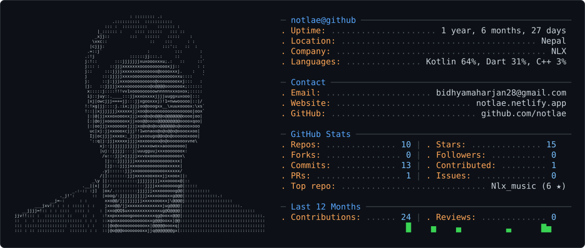

<picture>
  <source media="(prefers-color-scheme: dark)" srcset="dark_mode.svg" />
  <source media="(prefers-color-scheme: light)" srcset="light_mode.svg" />
  
</picture>

# Hey, I'm Not_lae ! 👋

# 💫 About Me:
I am an Boy which is curious about every thing,  so I welcome here i like coding because it make me more curous every time . 

## 🌐 Socials:
    

# 💻 Tech Stack:
                 
# 📊 GitHub Stats:
 
 

## 🏆 GitHub Trophies

### ✍️ Random Dev Quote

# If you want to contact me:

### my protofoilo

### my facebook

### my instagram 

